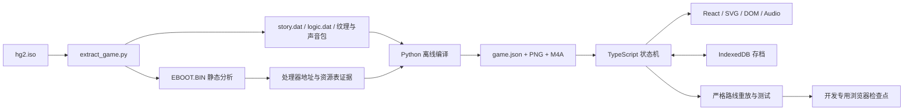

# 架构与改动地图

## 数据流

## 分层责任

| 层 | 文件 | 修改时需要一起验证 |
| --- | --- | --- |
| 镜像/索引 | extract_game.py、audit_chapter.py | 字节边界、相对偏移、源指纹；不执行 PSP 程序 |
| 文本/剧情 | compile_prologue.py、compile_chapter.py、scripts/data/ | Unicode、姓名、标签和释义，严格解码失败；所有原始 offset 保留 |
| 媒体 | compile_assets.py、compile_audio.py、compile_animations.py | 资源 ID→文件、尺寸、子动画、无音效证据、缓存更新 |
| 核心状态机 | engine.ts | 纯状态变换；条件、变量、勇气、答案、结束位置；未知指令 fail closed |
| 存档 | engine.ts validateSave、storage.ts | JSON 往返、当前位置合法性、完整历史、跨章初始化、revision |
| 画面 | scene.ts、animation.ts、AnimationScene.tsx | 原图尺寸、脚本变换、相机裁剪、时钟、父子动画 |
| 音频 | AudioScene.tsx、App.tsx BGM | 播放手势、静音、音量、循环/单次、隐藏页面行为 |
| Web UI | App.tsx、App.css、LogicBoard.tsx | 场景在上、正文在下、触达、缩放、表单、焦点、模态框与通知 |

## 主要契约

- `game.json` 是生产入口，独立章节 JSON 用于现有工具/测试。合并时同 ID 的共享资源要确认语义一致；关系图纹理按 logic ID 命名，避免互相覆盖。
- `Instruction` 同时携带 op/args 或已解码 text，以及原始 offset/length。运行时 pc 是指令数组中下一条索引，不是原始字节偏移。
- GameState 的 mode 是 Web 交互边界：page/input/choice/logic/confirm/ended，error 是失败。页面上同一幅图可以覆盖多条脚本记录，静态有图不等于停顿点能看到图。
- `run` 到达交互边界返回；advance/choose/submitName/finishLogic/confirmResult 恢复执行。业务逻辑属于 VM，不能塞到 React 按钮里硬编码绕过剧情。
- 状态中的 layers/sprites/animations 分别对应背景、立绘、动画。背景源像素坐标通过 480×272 相机裁切；动画设计坐标按当前逆向结果映射。
- UI 的阅读时钟不随普通翻页销毁；同动画的新变体/开始时间应重置，读档和新开流程重建实例。震动/闪光由 Web Animations 独立触发。
- `enterChapter` 保留姓名、历史、已发现内容等进度，由原始初始化记录负责本章变量重置。跨章必须检查对应章节的实际初始化语义。
- 运行时不读取 output/，不依赖 ISO、反汇编或码表。`tests/*.html` 是开发入口；生产 Vite build 只从根 index.html 开始。

## 工具边界

静态审计描述“源里有什么”；check:game 描述“已编译包的引用是否完整”；严格重放描述“一条具体路线是否达到预期”；覆盖巡检描述“实际访问了哪些记录/选择”；浏览器走查描述“用户是否看得到且操作得到”。五者不能互相替代。
